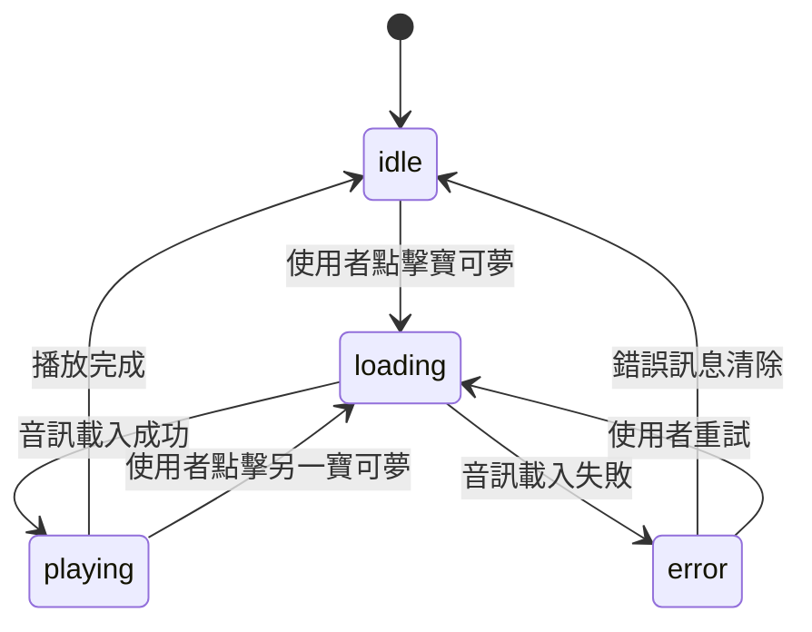
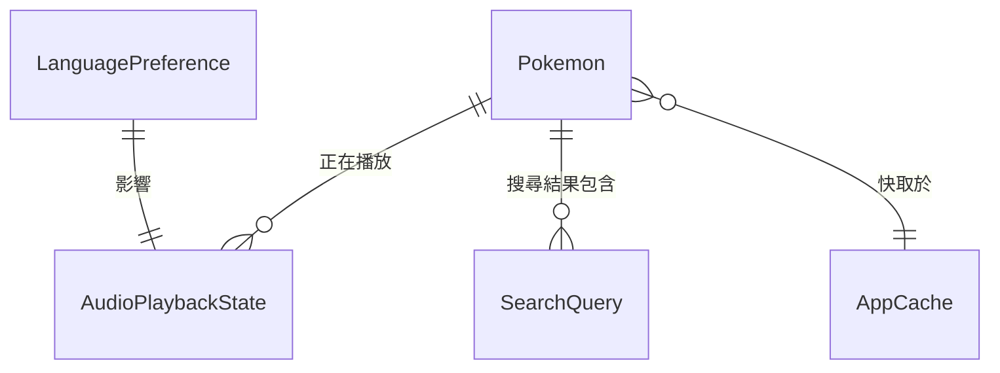

# 資料模型

**專案**: 寶可夢語音圖鑑
**日期**: 2025-11-04
**狀態**: 設計階段

## 概述

本文件定義寶可夢語音圖鑑應用程式的核心資料模型、實體關係、驗證規則和狀態轉換。所有模型使用 TypeScript 介面定義，遵循嚴格型別安全原則。

---

## 核心實體

### 1. Pokemon (寶可夢)

代表單一寶可夢的完整資訊。

```typescript
interface Pokemon {
  // 唯一識別碼（PokéAPI 的 ID）
  id: number;

  // 寶可夢名稱
  name: {
    en: string;      // 英文名稱（如 "Pikachu"）
    zh: string;      // 繁體中文名稱（如 "皮卡丘"）
  };

  // 圖鑑編號（格式：001, 002, ...）
  dexNumber: string;

  // 圖片資源
  sprites: {
    official: string;     // 官方美術圖（高畫質）
    icon: string;         // 小圖示
  };

  // 音訊資源（可選，視音訊生成方案而定）
  audio?: {
    en?: string;          // 英文發音 URL（Web Speech API 或預錄）
    zh?: string;          // 中文發音 URL
  };

  // 後設資料
  metadata: {
    generation: number;   // 世代（1-9）
    isSpecialForm: boolean; // 是否為特殊型態
  };
}
```

**驗證規則**：
- `id`: 必須 > 0
- `dexNumber`: 必須符合格式 /^\d{3,4}$/ （如 "001", "0025", "1025"）
- `name.en`: 必須非空字串
- `name.zh`: 必須非空字串
- `sprites.official`: 必須是有效的 URL 或相對路徑
- `generation`: 必須在 1-9 之間

**資料來源**：
- PokéAPI (`https://pokeapi.co/api/v2/pokemon/{id}`)
- 中文名稱：自訂翻譯表或 PokéAPI 的中文資源

---

### 2. LanguagePreference (語言偏好)

使用者的語言播放設定。

```typescript
type LanguageMode = 'zh-only' | 'en-only' | 'both';

interface LanguagePreference {
  // 語言模式
  mode: LanguageMode;

  // 當 mode 為 'both' 時的播放順序
  playbackOrder?: {
    first: 'zh' | 'en';   // 先播放的語言
    delay: number;        // 兩次播放間的延遲（毫秒）
  };

  // 最後更新時間（ISO 8601 格式）
  lastUpdated: string;

  // 音量設定（0.0 - 1.0）
  volume: number;
}
```

**驗證規則**：
- `mode`: 必須是 'zh-only' | 'en-only' | 'both'
- `volume`: 必須在 0.0 - 1.0 之間
- `playbackOrder.delay`: 必須 >= 0，建議值 500-1000 毫秒
- `lastUpdated`: 必須是有效的 ISO 8601 日期時間字串

**預設值**：
```typescript
const DEFAULT_PREFERENCE: LanguagePreference = {
  mode: 'both',
  playbackOrder: {
    first: 'zh',
    delay: 800,
  },
  lastUpdated: new Date().toISOString(),
  volume: 0.8,
};
```

**持久化**：儲存在 `localStorage` 的 `language-preference` 鍵

---

### 3. AudioPlaybackState (音訊播放狀態)

追蹤當前音訊播放的狀態。

```typescript
type PlaybackStatus = 'idle' | 'loading' | 'playing' | 'paused' | 'error';

interface AudioPlaybackState {
  // 當前播放狀態
  status: PlaybackStatus;

  // 正在播放的寶可夢 ID（null 表示無）
  currentPokemonId: number | null;

  // 當前播放的語言
  currentLanguage: 'zh' | 'en' | null;

  // 錯誤訊息（status 為 'error' 時）
  error: string | null;

  // 播放進度（0.0 - 1.0，可選）
  progress?: number;
}
```

**狀態轉換圖**：



**驗證規則**：
- `status`: 必須是有效的 PlaybackStatus
- `currentPokemonId`: status 為 'playing' 時必須非 null
- `currentLanguage`: status 為 'playing' 時必須非 null
- `progress`: 必須在 0.0 - 1.0 之間

---

### 4. SearchQuery (搜尋查詢)

使用者搜尋的查詢狀態。

```typescript
interface SearchQuery {
  // 搜尋文字
  query: string;

  // 搜尋結果（寶可夢 ID 陣列）
  results: number[];

  // 搜尋是否進行中
  isSearching: boolean;

  // 最後搜尋時間
  lastSearchTime: number; // Unix timestamp
}
```

**搜尋邏輯**：
- 不區分大小寫
- 支援部分匹配（如「皮卡」匹配「皮卡丘」）
- 同時搜尋中英文名稱
- 即時搜尋（使用 debounce，延遲 300ms）

**驗證規則**：
- `query`: 可以是空字串（顯示所有結果）
- `results`: 必須是有效的寶可夢 ID 陣列
- `lastSearchTime`: 必須 >= 0

---

### 5. AppCache (應用程式快取)

管理寶可夢資料的本地快取。

```typescript
interface AppCache {
  // 快取版本（用於強制更新）
  version: string;

  // 寶可夢資料（以 ID 為鍵的字典）
  pokemon: Record<number, Pokemon>;

  // 快取建立時間
  createdAt: string; // ISO 8601

  // 快取過期時間
  expiresAt: string; // ISO 8601

  // 快取狀態
  status: 'fresh' | 'stale' | 'expired';
}
```

**快取策略**：
- 資料儲存在 `IndexedDB`（大型資料）
- 中繼資料儲存在 `localStorage`（快取版本、狀態）
- 快取有效期：7 天
- 過期後背景重新載入，顯示舊資料直到新資料就緒

**驗證規則**：
- `version`: 必須符合 SemVer 格式
- `pokemon`: 所有值必須是有效的 Pokemon 物件
- `createdAt`, `expiresAt`: 必須是有效的 ISO 8601 日期時間
- `status`: 必須是 'fresh' | 'stale' | 'expired'

---

## 實體關係



### 關係說明

1. **Pokemon ↔ AudioPlaybackState**:
   - 一個 Pokemon 可以有一個相關的播放狀態（0 或 1）
   - 一個 AudioPlaybackState 只對應一個 Pokemon（當 status 為 'playing'）

2. **Pokemon ↔ SearchQuery**:
   - 一個 SearchQuery 可以包含多個 Pokemon（搜尋結果）
   - 一個 Pokemon 可以出現在多個搜尋結果中

3. **Pokemon ↔ AppCache**:
   - 多個 Pokemon 儲存在一個 AppCache 中
   - 一個 AppCache 包含所有載入的 Pokemon 資料

4. **LanguagePreference ↔ AudioPlaybackState**:
   - LanguagePreference 決定 AudioPlaybackState 的播放行為
   - 一對一關係（全域單一偏好設定）

---

## 資料流

### 1. 初始載入流程

```
使用者開啟應用
    ↓
檢查 AppCache.status
    ↓
├─ 'fresh' → 從 IndexedDB 載入資料
├─ 'stale' → 顯示舊資料，背景更新
└─ 'expired' 或不存在 → 從 PokéAPI 載入
    ↓
更新 AppCache
    ↓
顯示 Pokemon 列表
```

### 2. 音訊播放流程

```
使用者點擊 Pokemon
    ↓
AudioPlaybackState.status = 'loading'
    ↓
檢查 LanguagePreference.mode
    ↓
├─ 'zh-only' → 播放中文
├─ 'en-only' → 播放英文
└─ 'both' → 依序播放中文 + 英文
    ↓
AudioPlaybackState.status = 'playing'
    ↓
播放完成
    ↓
AudioPlaybackState.status = 'idle'
```

### 3. 搜尋流程

```
使用者輸入查詢
    ↓
Debounce 300ms
    ↓
SearchQuery.isSearching = true
    ↓
過濾 Pokemon 陣列
    ↓
更新 SearchQuery.results
    ↓
SearchQuery.isSearching = false
    ↓
更新 UI 顯示結果
```

---

## 型別定義檔案結構

建議的型別定義檔案組織：

```
src/types/
├── pokemon.ts          # Pokemon 介面
├── audio.ts            # AudioPlaybackState, LanguagePreference
├── search.ts           # SearchQuery
├── cache.ts            # AppCache
└── index.ts            # 匯出所有型別
```

---

## 資料驗證工具

建議使用 Zod 進行執行時型別驗證：

```typescript
import { z } from 'zod';

// Pokemon Schema
export const PokemonSchema = z.object({
  id: z.number().positive(),
  name: z.object({
    en: z.string().min(1),
    zh: z.string().min(1),
  }),
  dexNumber: z.string().regex(/^\d{3,4}$/),
  sprites: z.object({
    official: z.string().url(),
    icon: z.string().url(),
  }),
  audio: z.object({
    en: z.string().url().optional(),
    zh: z.string().url().optional(),
  }).optional(),
  metadata: z.object({
    generation: z.number().min(1).max(9),
    isSpecialForm: z.boolean(),
  }),
});

// LanguagePreference Schema
export const LanguagePreferenceSchema = z.object({
  mode: z.enum(['zh-only', 'en-only', 'both']),
  playbackOrder: z.object({
    first: z.enum(['zh', 'en']),
    delay: z.number().nonnegative(),
  }).optional(),
  lastUpdated: z.string().datetime(),
  volume: z.number().min(0).max(1),
});

// 使用範例
const validatePokemon = (data: unknown): Pokemon => {
  return PokemonSchema.parse(data);
};
```

---

## 效能考量

### IndexedDB 資料量估算

假設 1000 隻寶可夢：
- 平均每隻寶可夢資料大小：~2KB（包含名稱、圖片 URL、中繼資料）
- 總資料量：~2MB
- IndexedDB 儲存限制：通常 > 50MB（Chrome, Firefox）
- **結論**：足夠儲存所有資料

### LocalStorage 使用

- `language-preference`: ~200 bytes
- `cache-metadata`: ~500 bytes
- 總計：< 1KB（LocalStorage 限制通常為 5-10MB）
- **結論**：安全

---

## 未來擴充性

### 潛在新實體

1. **UserProfile**: 使用者個人資料（如收藏的寶可夢）
2. **PlayHistory**: 播放歷史記錄（學習進度追蹤）
3. **PokemonDetail**: 詳細資訊（屬性、能力、進化鏈）

### 版本遷移策略

當資料模型變更時：
1. 更新 `AppCache.version`
2. 提供資料遷移函式
3. 在載入時檢查版本並執行遷移
4. 記錄遷移日誌以便除錯

---

## 參考資源

- **PokéAPI 文件**: https://pokeapi.co/docs/v2
- **TypeScript 手冊**: https://www.typescriptlang.org/docs/
- **Zod 文件**: https://zod.dev/
- **IndexedDB API**: https://developer.mozilla.org/en-US/docs/Web/API/IndexedDB_API
