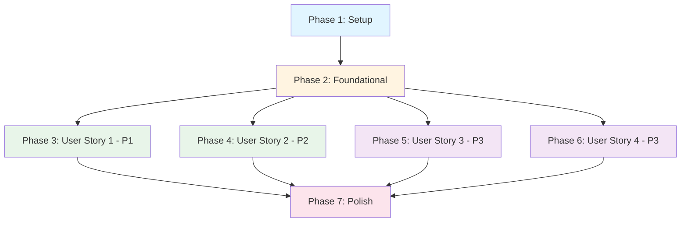

# Tasks: Pokemon Audio Pokedex

**Input**: Design documents from `/specs/001-pokemon-audio-pokedex/`
**Prerequisites**: plan.md (required), spec.md (required), research.md, data-model.md, contracts/

**Tests**: This project follows TDD (Test-Driven Development) - tests MUST be written FIRST and FAIL before implementation.

**Organization**: Tasks are grouped by user story to enable independent implementation and testing of each story.

## Format: `[ID] [P?] [Story] Description`

- **[P]**: Can run in parallel (different files, no dependencies)
- **[Story]**: Which user story this task belongs to (e.g., US1, US2, US3, US4)
- Include exact file paths in descriptions

## Path Conventions

This is a monorepo with the web app located at `pokedex-for-kids-web/`:
- **Web app source**: `pokedex-for-kids-web/src/`
- **Web app tests**: `pokedex-for-kids-web/__tests__/`
- **App routes**: `pokedex-for-kids-web/src/app/`
- **Components**: `pokedex-for-kids-web/src/components/`
- **Hooks**: `pokedex-for-kids-web/src/hooks/`
- **Types**: `pokedex-for-kids-web/src/types/`
- **Utils**: `pokedex-for-kids-web/src/utils/`
- **Services**: `pokedex-for-kids-web/src/services/`

---

## Phase 1: Setup (Shared Infrastructure)

**Purpose**: Project initialization and dependency upgrades

- [X] T001 Upgrade Next.js to 15.5.0 and React to 19.2.0 in pokedex-for-kids-web/package.json
- [X] T002 Upgrade Tailwind CSS to 4.0.0 in pokedex-for-kids-web/package.json
- [X] T003 [P] Install shadcn/ui CLI and initialize configuration in pokedex-for-kids-web/
- [X] T004 [P] Install required shadcn/ui components: Button, Card, Input, Select in pokedex-for-kids-web/src/components/ui/
- [X] T005 [P] Install @tanstack/react-virtual for virtual scrolling in pokedex-for-kids-web/package.json
- [X] T006 [P] Configure Jest and React Testing Library for React 19 in pokedex-for-kids-web/jest.config.js
- [X] T007 Create directory structure: src/{components,hooks,types,utils,services} in pokedex-for-kids-web/

---

## Phase 2: Foundational (Blocking Prerequisites)

**Purpose**: Core infrastructure that MUST be complete before ANY user story can be implemented

**⚠️ CRITICAL**: No user story work can begin until this phase is complete

- [X] T008 Define shared TypeScript types in pokedex-for-kids-web/src/types/index.ts (Pokemon, LanguagePreference, AudioPlaybackState, SearchQuery, AppCache)
- [X] T009 [P] Implement PokéAPI client service in pokedex-for-kids-web/src/services/pokeapi.ts with error handling and retry logic
- [X] T010 [P] Implement IndexedDB cache service in pokedex-for-kids-web/src/services/cache.ts for Pokemon data
- [X] T011 [P] Implement Web Speech API wrapper in pokedex-for-kids-web/src/services/speech.ts with browser compatibility check
- [X] T012 [P] Create utility functions for name matching in pokedex-for-kids-web/src/utils/search.ts (fuzzy matching, Chinese/English support)
- [X] T013 [P] Create utility functions for performance monitoring in pokedex-for-kids-web/src/utils/performance.ts (FPS tracking, latency measurement)
- [X] T014 Setup error handling constants and messages in pokedex-for-kids-web/src/constants/errors.ts
- [X] T015 Setup language configuration constants in pokedex-for-kids-web/src/constants/languages.ts (zh-TW, en-US, timing intervals)

**Checkpoint**: Foundation ready - user story implementation can now begin in parallel

---

## Phase 3: User Story 1 - Browse Pokemon List (Priority: P1) 🎯 MVP

**Goal**: Display a complete list of all Pokemon with images and bilingual names

**Independent Test**: Open the application and verify that a scrollable Pokemon list is visible with images and Chinese/English names

### Tests for User Story 1 (TDD - Write First)

> **NOTE: Write these tests FIRST, ensure they FAIL before implementation**

- [X] T016 [P] [US1] Integration test for Pokemon list rendering in pokedex-for-kids-web/__tests__/integration/pokemon-list.test.tsx (tests: list displays, loading state, error state, scroll behavior)
- [X] T017 [P] [US1] Component test for PokemonCard in pokedex-for-kids-web/__tests__/components/PokemonCard.test.tsx (tests: image display, bilingual names, click interaction)
- [X] T018 [P] [US1] Component test for LoadingSpinner in pokedex-for-kids-web/__tests__/components/LoadingSpinner.test.tsx

### Implementation for User Story 1

- [X] T019 [P] [US1] Implement usePokemonList hook in pokedex-for-kids-web/src/hooks/usePokemonList.ts (fetch data, cache, loading states, error handling)
- [X] T020 [P] [US1] Implement useVirtualScroll hook in pokedex-for-kids-web/src/hooks/useVirtualScroll.ts (virtualizer setup, performance optimization for 1000+ items)
- [X] T021 [P] [US1] Create LoadingSpinner component in pokedex-for-kids-web/src/components/LoadingSpinner.tsx (accessible, animated)
- [X] T022 [US1] Create PokemonCard component in pokedex-for-kids-web/src/components/PokemonCard.tsx (display image, Chinese/English names, click handler prop)
- [X] T023 [US1] Create PokemonList component in pokedex-for-kids-web/src/components/PokemonList.tsx (virtual scroll integration, empty state, error state)
- [X] T024 [US1] Implement home page in pokedex-for-kids-web/src/app/page.tsx (integrate PokemonList, loading states)
- [X] T025 [US1] Add ErrorBoundary component in pokedex-for-kids-web/src/components/ErrorBoundary.tsx (catch and display errors gracefully)
- [X] T026 [US1] Verify all US1 tests pass and list displays correctly with smooth 60 FPS scrolling

**Checkpoint**: At this point, User Story 1 should be fully functional and testable independently

---

## Phase 4: User Story 2 - Play Pokemon Name Audio (Priority: P2)

**Goal**: Click any Pokemon to hear its name spoken using Web Speech API

**Independent Test**: Click any Pokemon card and verify that audio plays with visual feedback

### Tests for User Story 2 (TDD - Write First)

> **NOTE: Write these tests FIRST, ensure they FAIL before implementation**

- [X] T027 [P] [US2] Integration test for audio playback in pokedex-for-kids-web/__tests__/integration/audio-playback.test.tsx (tests: click plays audio, concurrent click stops previous, visual feedback, completion state, error handling)
- [X] T028 [P] [US2] Hook test for useAudioPlayer in pokedex-for-kids-web/__tests__/hooks/useAudioPlayer.test.ts (tests: play function, stop on new play, state management, error cases)

### Implementation for User Story 2

- [X] T029 [US2] Implement useAudioPlayer hook in pokedex-for-kids-web/src/hooks/useAudioPlayer.ts (Web Speech API integration, queue management, state tracking, error handling)
- [X] T030 [US2] Create AudioPlayer component in pokedex-for-kids-web/src/components/AudioPlayer.tsx (headless component, manages global audio state)
- [X] T031 [US2] Update PokemonCard component to support click-to-play in pokedex-for-kids-web/src/components/PokemonCard.tsx (add click handler, visual feedback states: idle/playing/error)
- [X] T032 [US2] Add visual feedback styles in pokedex-for-kids-web/src/components/PokemonCard.tsx (highlight during playback, pulse animation, completion transition)
- [X] T033 [US2] Implement audio error handling UI in pokedex-for-kids-web/src/components/AudioPlayer.tsx (toast notifications for errors, browser unsupported message)
- [X] T034 [US2] Integrate AudioPlayer into home page in pokedex-for-kids-web/src/app/page.tsx
- [X] T035 [US2] Verify all US2 tests pass and audio plays correctly with proper visual feedback

**Checkpoint**: At this point, User Stories 1 AND 2 should both work independently

---

## Phase 5: User Story 3 - Search Pokemon (Priority: P3)

**Goal**: Search and filter Pokemon by Chinese or English name with partial matching

**Independent Test**: Type a Pokemon name (Chinese or English) in the search bar and verify the list filters correctly in under 500ms

### Tests for User Story 3 (TDD - Write First)

> **NOTE: Write these tests FIRST, ensure they FAIL before implementation**

- [X] T036 [P] [US3] Integration test for search functionality in pokedex-for-kids-web/__tests__/integration/search.test.tsx (tests: Chinese search, English search, partial match, clear search, no results, search + play audio, performance < 500ms)
- [X] T037 [P] [US3] Hook test for useSearch in pokedex-for-kids-web/__tests__/hooks/useSearch.test.ts (tests: debounced search, filter logic, clear function, performance)
- [X] T038 [P] [US3] Component test for SearchBar in pokedex-for-kids-web/__tests__/components/SearchBar.test.tsx (tests: input handling, clear button, accessibility)

### Implementation for User Story 3

- [X] T039 [US3] Implement useSearch hook in pokedex-for-kids-web/src/hooks/useSearch.ts (debounced search, fuzzy matching for Chinese/English, performance optimized for < 500ms)
- [X] T040 [US3] Create SearchBar component in pokedex-for-kids-web/src/components/SearchBar.tsx (input field, clear button, accessible, debounced input handling)
- [X] T041 [US3] Update PokemonList component to support filtered results in pokedex-for-kids-web/src/components/PokemonList.tsx (display filtered items, maintain virtual scroll)
- [X] T042 [US3] Create EmptyState component in pokedex-for-kids-web/src/components/EmptyState.tsx (display when no search results)
- [X] T043 [US3] Integrate SearchBar into home page in pokedex-for-kids-web/src/app/page.tsx (connect to useSearch, pass filtered results to PokemonList)
- [X] T044 [US3] Verify search performance < 500ms with performance monitoring in pokedex-for-kids-web/src/utils/performance.ts
- [X] T045 [US3] Verify all US3 tests pass and search filters correctly with Chinese/English partial matching

**Checkpoint**: At this point, User Stories 1, 2, AND 3 should all work independently

---

## Phase 6: User Story 4 - Language Mode Selection (Priority: P3)

**Goal**: Dedicated settings page to select language playback mode (Chinese only, English only, or Bilingual with 800ms interval)

**Independent Test**: Navigate to settings page, switch language mode, return to home, and verify audio plays in the selected language mode

### Tests for User Story 4 (TDD - Write First)

> **NOTE: Write these tests FIRST, ensure they FAIL before implementation**

- [X] T046 [P] [US4] Integration test for language settings in pokedex-for-kids-web/__tests__/integration/language-settings.test.tsx (tests: navigate to settings, select mode, persist on reload, audio plays correct language, 800ms bilingual interval)
- [X] T047 [P] [US4] Hook test for usePreferences in pokedex-for-kids-web/__tests__/hooks/usePreferences.test.ts (tests: get/set language preference, persistence)
- [X] T048 [P] [US4] Hook test for useLocalStorage in pokedex-for-kids-web/__tests__/hooks/useLocalStorage.test.ts (tests: read/write/clear, serialization)
- [X] T049 [P] [US4] Component test for LanguageSelector in pokedex-for-kids-web/__tests__/components/LanguageSelector.test.tsx (tests: display options, selection, accessibility)

### Implementation for User Story 4

- [X] T050 [P] [US4] Implement useLocalStorage hook in pokedex-for-kids-web/src/hooks/useLocalStorage.ts (generic localStorage wrapper with TypeScript support)
- [X] T051 [US4] Implement usePreferences hook in pokedex-for-kids-web/src/hooks/usePreferences.ts (manage language preference with useLocalStorage, default to bilingual)
- [X] T052 [US4] Create LanguageSelector component in pokedex-for-kids-web/src/components/LanguageSelector.tsx (radio buttons or select for 3 modes: Chinese only, English only, Bilingual)
- [X] T053 [US4] Create settings page in pokedex-for-kids-web/src/app/settings/page.tsx (display LanguageSelector, back navigation)
- [X] T054 [US4] Add settings button to home page header in pokedex-for-kids-web/src/app/page.tsx (navigation to /settings)
- [X] T055 [US4] Update useAudioPlayer hook to support language modes in pokedex-for-kids-web/src/hooks/useAudioPlayer.ts (play Chinese only, English only, or both with 800ms delay)
- [X] T056 [US4] Implement 800ms interval timing for bilingual mode in pokedex-for-kids-web/src/hooks/useAudioPlayer.ts (async timing, cancellation on stop)
- [X] T057 [US4] Integrate usePreferences into AudioPlayer in pokedex-for-kids-web/src/components/AudioPlayer.tsx (read language preference, pass to useAudioPlayer)
- [X] T058 [US4] Add settings navigation icon/button to app layout in pokedex-for-kids-web/src/app/layout.tsx
- [X] T059 [US4] Verify all US4 tests pass and language modes work correctly with 800ms bilingual interval

**Checkpoint**: All user stories (US1-US4) should now be independently functional

---

## Phase 7: Polish & Cross-Cutting Concerns

**Purpose**: Improvements that affect multiple user stories, performance optimization, and deployment

- [X] T060 [P] Performance audit: Verify 60 FPS scrolling with React DevTools Profiler across all user stories
- [X] T061 [P] Accessibility audit: Verify WCAG 2.1 AA compliance (keyboard navigation, ARIA labels, contrast ratios) in pokedex-for-kids-web/
- [X] T062 [P] Add loading skeletons for better perceived performance in pokedex-for-kids-web/src/components/PokemonCardSkeleton.tsx
- [X] T063 [P] Implement progressive image loading with blur placeholders in pokedex-for-kids-web/src/components/PokemonCard.tsx
- [X] T064 [P] Add error retry mechanism for failed API calls in pokedex-for-kids-web/src/services/pokeapi.ts
- [X] T065 [P] Add analytics events (page view, search, audio play) in pokedex-for-kids-web/src/utils/analytics.ts (OPTIONAL)
- [X] T066 Optimize bundle size: Code splitting and lazy loading for settings page in pokedex-for-kids-web/src/app/settings/page.tsx
- [X] T067 Add meta tags and Open Graph for SEO in pokedex-for-kids-web/src/app/layout.tsx
- [X] T068 Configure static export for GitHub Pages in pokedex-for-kids-web/next.config.js (output: 'export', basePath if needed)
- [X] T069 Create build script for static export in pokedex-for-kids-web/package.json
- [X] T070 Add favicon and app icons in pokedex-for-kids-web/public/
- [X] T071 Run full test suite and verify all tests pass across US1-US4
- [X] T072 Validate quickstart.md instructions work end-to-end
- [X] T073 Build static export and verify deployment readiness

---

## Dependencies & Execution Order

### Phase Dependencies



### Blocking Dependencies

1. **Phase 1 (Setup)** → **Phase 2 (Foundational)**: Must upgrade dependencies and create structure before building core services
2. **Phase 2 (Foundational)** → **All User Stories**: Core services (PokéAPI, Cache, Speech API) MUST be complete before any UI work
3. **User Story 2** depends on **User Story 1**: AudioPlayer needs PokemonCard to integrate click handlers
4. **User Story 3** depends on **User Story 1**: Search filters the Pokemon list
5. **User Story 4** depends on **User Story 2**: Language settings control audio playback behavior

### User Story Dependencies

- **User Story 1 (P1)**: Can start after Foundational (Phase 2) - **No dependencies on other stories**
- **User Story 2 (P2)**: Can start after US1 is complete - **Depends on PokemonCard from US1**
- **User Story 3 (P3)**: Can start after US1 is complete - **Depends on PokemonList from US1**
- **User Story 4 (P3)**: Can start after US2 is complete - **Depends on useAudioPlayer from US2**

### Within Each User Story

1. **Tests MUST be written FIRST** and verified to FAIL (TDD requirement)
2. **Hooks before Components**: Custom hooks provide logic that components consume
3. **Leaf Components before Container Components**: Build small pieces before assembling them
4. **Core Implementation before Integration**: Complete the story's core features before connecting to other stories
5. **Verify Tests Pass**: Each story checkpoint requires all tests passing

### Parallel Opportunities

#### Phase 1 (Setup) - Parallel Tasks
```bash
# All setup tasks can run in parallel:
T003, T004, T005, T006 - Install and configure tools
```

#### Phase 2 (Foundational) - Parallel Tasks
```bash
# After T008 (types), these can run in parallel:
T009 - PokéAPI client
T010 - IndexedDB cache
T011 - Web Speech API wrapper
T012 - Search utilities
T013 - Performance utilities
```

#### User Story 1 - Parallel Tasks
```bash
# Tests (write first, in parallel):
T016 - Integration test
T017 - PokemonCard test
T018 - LoadingSpinner test

# After tests fail, implementation (some parallel):
T019 - usePokemonList hook
T020 - useVirtualScroll hook
T021 - LoadingSpinner component
# Then T022-T026 sequentially for integration
```

#### User Story 2 - Parallel Tasks
```bash
# Tests (write first, in parallel):
T027 - Integration test
T028 - useAudioPlayer test

# After tests fail, T029-T035 mostly sequential for audio integration
```

#### User Story 3 - Parallel Tasks
```bash
# Tests (write first, in parallel):
T036 - Integration test
T037 - useSearch test
T038 - SearchBar test

# After tests fail, T039-T045 mostly sequential for search integration
```

#### User Story 4 - Parallel Tasks
```bash
# Tests (write first, in parallel):
T046 - Integration test
T047 - usePreferences test
T048 - useLocalStorage test
T049 - LanguageSelector test

# After tests fail, implementation:
T050 - useLocalStorage hook
T051 - usePreferences hook
# Can run in parallel
# Then T052-T059 for integration
```

#### Phase 7 (Polish) - Parallel Tasks
```bash
# Many polish tasks are independent:
T060 - Performance audit
T061 - Accessibility audit
T062 - Loading skeletons
T063 - Progressive images
T064 - Error retry
T065 - Analytics
```

---

## Implementation Strategy

### MVP First (User Story 1 Only)

**Timeline**: ~2-3 days for solo developer

1. ✅ Complete Phase 1: Setup (T001-T007) - ~2 hours
2. ✅ Complete Phase 2: Foundational (T008-T015) - **CRITICAL** - ~1 day
3. ✅ Complete Phase 3: User Story 1 (T016-T026) - ~1 day
4. **STOP and VALIDATE**: Test User Story 1 independently
   - Can you see the Pokemon list?
   - Does it scroll smoothly at 60 FPS?
   - Do images and names load correctly?
5. Deploy to GitHub Pages if ready (basic functionality)

**Deliverable**: Working Pokemon list viewer

### Incremental Delivery (Priority Order)

**Timeline**: ~1-2 weeks for solo developer

1. ✅ Setup + Foundational (T001-T015) → Foundation ready - ~1.5 days
2. ✅ User Story 1 (T016-T026) → Test independently → Deploy/Demo (MVP!) - ~1 day
3. ✅ User Story 2 (T027-T035) → Test independently → Deploy/Demo - ~1-2 days
4. ✅ User Story 3 (T036-T045) → Test independently → Deploy/Demo - ~1 day
5. ✅ User Story 4 (T046-T059) → Test independently → Deploy/Demo - ~1-2 days
6. ✅ Polish (T060-T073) → Final deployment - ~1-2 days

Each story adds value without breaking previous stories.

### Parallel Team Strategy

**Timeline**: ~1 week with 3-4 developers

With multiple developers:

1. **Week 1, Day 1-2**: Team completes Setup + Foundational together (T001-T015)
2. **Week 1, Day 3-5**: Once Foundational is done, PARALLEL WORK:
   - **Developer A**: User Story 1 (T016-T026) - Pokemon List
   - **Developer B**: Start preparations for User Story 2 tests (T027-T028)
   - **Developer C**: Start preparations for User Story 3 tests (T036-T038)
3. **Week 2, Day 1-3**: Sequential integration:
   - Developer B completes User Story 2 (T029-T035) after US1 done
   - Developer C completes User Story 3 (T039-T045) after US1 done
   - Developer D starts User Story 4 tests (T046-T049)
4. **Week 2, Day 4-5**:
   - Developer D completes User Story 4 (T050-T059)
   - Team does Polish tasks in parallel (T060-T073)

**Note**: While some user stories have dependencies, test writing can start in parallel, and multiple developers can work on independent components simultaneously.

---

## Parallel Example: User Story 1

```bash
# Step 1: Launch all tests for User Story 1 together (TDD - write first):
Task T016: "Integration test for Pokemon list rendering in __tests__/integration/pokemon-list.test.tsx"
Task T017: "Component test for PokemonCard in __tests__/components/PokemonCard.test.tsx"
Task T018: "Component test for LoadingSpinner in __tests__/components/LoadingSpinner.test.tsx"
# Verify all tests FAIL (red phase)

# Step 2: Launch parallel implementation tasks:
Task T019: "Implement usePokemonList hook in src/hooks/usePokemonList.ts"
Task T020: "Implement useVirtualScroll hook in src/hooks/useVirtualScroll.ts"
Task T021: "Create LoadingSpinner component in src/components/LoadingSpinner.tsx"

# Step 3: Sequential integration (after parallel tasks complete):
Task T022: "Create PokemonCard component in src/components/PokemonCard.tsx"
Task T023: "Create PokemonList component in src/components/PokemonList.tsx"
Task T024: "Implement home page in src/app/page.tsx"
Task T025: "Add ErrorBoundary component in src/components/ErrorBoundary.tsx"

# Step 4: Verify tests PASS (green phase):
Task T026: "Verify all US1 tests pass and list displays correctly with smooth 60 FPS scrolling"
```

---

## Notes

### Format Conventions
- **[P]** tasks = different files, no dependencies, can run in parallel
- **[Story]** label (US1, US2, US3, US4) maps task to specific user story for traceability
- Each user story should be independently completable and testable

### TDD Requirements (from Constitution)
- **Always write tests FIRST** before implementation
- Verify tests **FAIL** before writing code (red phase)
- Write minimal code to make tests **PASS** (green phase)
- Refactor while keeping tests green (refactor phase)

### Testing Standards
- **Integration tests**: Test complete user journeys (e.g., load page → see list → click → hear audio)
- **Component tests**: Test individual React components in isolation
- **Hook tests**: Test custom hooks with React Testing Library's `renderHook`
- **Coverage target**: Aim for >80% coverage on critical paths (US1-US2)

### Performance Targets
- **List scrolling**: Maintain 60 FPS with 1000+ items (virtual scroll)
- **Search filtering**: Complete in < 500ms
- **Initial load**: Display skeleton/loading state within 100ms
- **Audio playback**: Start within 200ms of click

### Accessibility Requirements
- **Keyboard navigation**: All interactive elements must be keyboard accessible
- **Screen reader**: Proper ARIA labels for all components
- **Focus management**: Visible focus indicators, logical tab order
- **Color contrast**: WCAG 2.1 AA compliant (4.5:1 for text)

### Commit Strategy
- Commit after each task or logical group of tasks
- Use descriptive commit messages following conventional commits
- Reference task IDs in commits (e.g., "feat(T022): create PokemonCard component [US1]")

### Story Independence
- Each user story should work independently
- Verify each story at its checkpoint before proceeding
- Stop at any checkpoint to demo/validate
- Avoid creating dependencies that break story independence

### Common Pitfalls to Avoid
- ❌ Vague tasks without file paths
- ❌ Multiple developers editing same file simultaneously
- ❌ Cross-story dependencies that break independence
- ❌ Skipping test-writing phase in TDD
- ❌ Not verifying tests fail before implementing
- ❌ Implementing features without corresponding tests

### Deployment
- Final output: Static site for GitHub Pages
- Configure `next.config.js` with `output: 'export'`
- Set `basePath` if deploying to subdirectory
- Verify all client-side features work without server

---

## Success Criteria

### User Story 1 Success
- [ ] Pokemon list displays all 1000+ Pokemon
- [ ] Images load progressively with placeholders
- [ ] Chinese and English names display correctly
- [ ] Smooth 60 FPS scrolling with virtual scroll
- [ ] Loading state displays during fetch
- [ ] Error boundary catches and displays errors

### User Story 2 Success
- [ ] Click any Pokemon card plays audio
- [ ] Visual feedback during playback (highlight/animation)
- [ ] Clicking another Pokemon stops previous audio
- [ ] Audio error displays user-friendly message
- [ ] Web Speech API browser support detected

### User Story 3 Success
- [ ] Search filters results in < 500ms
- [ ] Chinese partial matching works (e.g., "皮卡" finds "皮卡丘")
- [ ] English partial matching works (e.g., "pika" finds "Pikachu")
- [ ] Empty state displays when no results
- [ ] Clearing search restores full list
- [ ] Search results can still play audio

### User Story 4 Success
- [ ] Settings page accessible from home
- [ ] Three language modes selectable (Chinese only, English only, Bilingual)
- [ ] Selection persists across page reloads
- [ ] Chinese only mode plays Chinese only
- [ ] English only mode plays English only
- [ ] Bilingual mode plays English first, then Chinese after 800ms
- [ ] 800ms interval timing is accurate (+/- 50ms)

### Overall Project Success
- [ ] All integration tests pass
- [ ] All component tests pass
- [ ] All hook tests pass
- [ ] Performance targets met (60 FPS, < 500ms search)
- [ ] Accessibility audit passes WCAG 2.1 AA
- [ ] Static build succeeds
- [ ] Deployment to GitHub Pages works
- [ ] Quickstart instructions validated end-to-end
